ระบบเว็ปไซต์ซื้อขายเกมออนไลน์

1.ภาพรวมของระบบ

WhatGame เป็นระบบที่สามารถซื้อเกมได้ครบจบภายในเว็ปไซต์ ไม่ว่าจะเป็นการเลือกดูสินค้า ใส่ตะกร้า กดสั่งซื้อ เเละสามารถดูสถานะสินค้าได้

ระบบยังมีส่วนหลังบ้านเเบ่งออกเป็น พนักงาน เเละผู้จัดการ ที่สามารถดูภาพรวมสินค้า เเละจัดการสินค้า รวมถึงสามารถตรวจสอบข้อมูลย้อนหลังได้อย่างสะดวก  เเละควบคุมสิทธิ์การเข้าถึงของผู้ใช้งานเเต่ละระดับอย่างชัดเจน

ระบบนี้ถูกพัฒนาขึ้นเพื่อ
	
	1.1 ให้ลูกค้าสั่งซื้อสินค้าได้ง่ายเเละสะดวกรวดเร็ว

	1.2 ช่วยให้พนักงานจัดการออเดอร์เเละสินค้าได้เป็นระบบมากขึ้น

	1.3 ผู้จัดการสามารถบริหารได้เป็นอย่างระบบ

2. บทบาทผู้ใช้งานเเละสิทธิ์การใช้งาน

	ระบบเเบ่งผู้ใช้งานเเบ่งออกเป็น 4 บทบาท

	2.1 User (ผู้ใช้งานทั่วไป) ผู้ใช้งานที่ยังไม่ได้ Login  สามารถเข้ามาดูเว็ปไซต์ได้ เช่น

		หน้า Home  สินค้า หรือรายละเอียดสินค้าต่างๆ รวมถึงสมัครสมาชิกหรือเข้าสู่ระบบได้ 
		เเต่จะยังไม่สามารถสั่งซื้อสินค้าได้ จนกว่าผู้ใช้จะ Login เข้าสู่ระบบ

		2.2 Staff (พนักงาน)   พนักงานจะสามารถดูเเลหน้าบ้านเเละหลังบ้านได้ โดยสามารถดูรายละเอียดคำสั่งซื้อได้ทั้งหมด เเละอัปเดตจัดการสินค้า เช่น Edit Delete  รวมไปถึงสามารถดูข้อมูล ผู้ใช้งานได้

		2.3 Manager (ผู้จัดการ)  ผู้จัดการสามารดูเเลหน้าบ้านเเละหลังบ้าน โดยดูภาพรวม
		ของสินค้า เเละพนักงาน ภาพรวมยอดขาย รายงานทางธุรกิจ การเเจกจ่ายโค้ดส่วน
		เเละรายงานสรุปยอดขายได้

		2.4 Admin (ผู้ดูเเลระบบ) จะดูเเลภาพรวมระบบทั้งหมด เช่น เเก้ไข ระงับการใช้งานสินค้า ลบโค้ดส่วนลด ลบสินค้า สามารถจัดการผู้ใช้งาน เช่น ระงับการใช้าน หรือ เเก้ไข เเละ ลบผู้ใช้งานได้

3. ขอบเขตของระบบ

		WhatGame รองรับระบบหลัก ดังนี้

		3.1 ระบบสมัครสมาชิกเเละเข้าสู่ระบบ พร้อมกำหนดสิทธิ์ตามการใช้งาน

		3.2 ระบบเเสดงสินค้าเเละรายละเอียดสินค้า
		
		3.3 ระบบตะกร้าสินค้าเเละการสั่งซื้อ รวมไปถึงการชำระเงิน

		3.4 ระบบสร้างสินค้า เเละดูสถานะสินค้า

		3.5 ระบบจัดการสินค้า เพิ่ม ระงับ เเก้ไข ลบ

		3.6 ระบบจัดการผู้ใช้งาน ระงับการใช้งาน เเก้ไข ลบ

		3.7 ระบบหลังบ้านที่มีการควบคุมสิทธิ์ การใช้งานทั้งหมมด

ผังงาน (Flowchart) WHATGAME

		ผังงานภาพรวมของระบบ  
        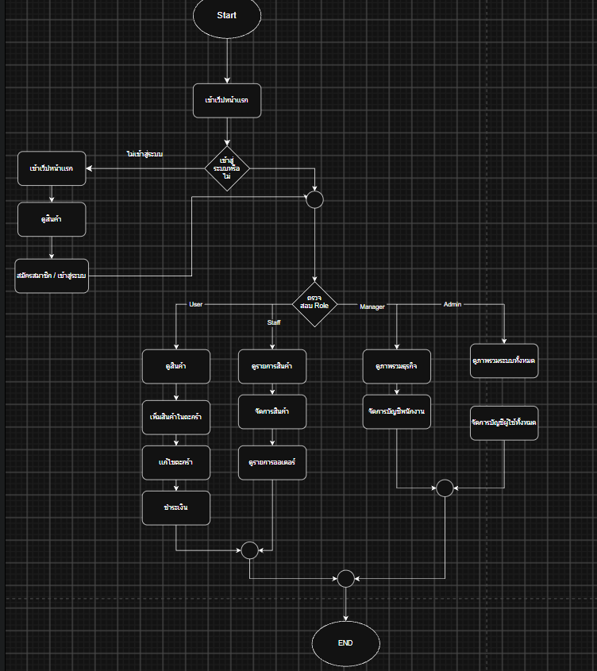

จากผังงานภาพรวมระบบ

	เริ่มต้นผู้ใช้งานเข้าสู่หน้าเเรกระบบ Start  ซึ่งเป็นหน้าที่หลักที่ใช้สำหรับเข้าถึงฟังก์ชั่นต่างๆของเว็ปไซต์ จากนั้นระบบจะตรวจสอบว่าผู้ใช้งานได้ทำการเข้าสู่ระบบเเล้วหรือไม่

	กรณีที่ผู้ใช้งาน ยังไม่ได้เข้าสู่ระบบ ระบบจะพาไปยังหน้าหลักทั่วไป ซึ่งผู้ใช้งานสามารถดูรายการสินค้า เเละเลือกสมัครสมาชิกหรือเข้าสู่ระบบ โดยเมื่อผู้ใช้งานทำการเข้าสู่ระบบสำเร็จเเล้วจะเข้าสู่ขั้นตอนการตรวจสอบสิทธิ์การใช้งานตาม Role

	ในกรณีที่ผู้ใช้งาน เข้าสู่ระบบเเล้ว ระบบจะทำการตรวจสอบ Role ของผู้ใช้งานเพื่อกำหนดสิทธิ์ในการเข้าถึงส่วนต่างๆ โดยสามารถเเบ่งออกเป็น 4 ประเภท

	
	User (ผู้ใช้งาน) สามารถดูสินค้า เเละเพิ่มสินค้าในตะกร้า เเก้ไขรายการสินค้า ทำการสั่ง
           ซื้อ เเละชำระเงิน

		Staff (พนักงาน) สามารถเข้าสู่ระบบหลังบ้าน เพื่อดูรายการคำสั่งซื้อ 
		อัปเดตสถานะคำสั่งซื้อ

		Manager (ผู้จัดการ) สามารถดูภาพรวมของระบบผ่าน Dashboard 
		และจัดการบัญชีผู้ใช้งานได้

		Admin (ผู้ดูแลระบบ) สามารถจัดการข้อมูลสินค้า เเละดูภาพรวมภายในของระบบ

		หลังจากผู้ใช้งานดำเนินการตามฟังก์ชันของตนเองเรียบร้อยแล้ว กระบวนการทำงานจะสิ้นสุดลงที่จุดสิ้นสุดของระบบ (END)

    2. ผังงานกระบวนการเข้าสู่ระบบ และ สมัครสมาชิก
	

    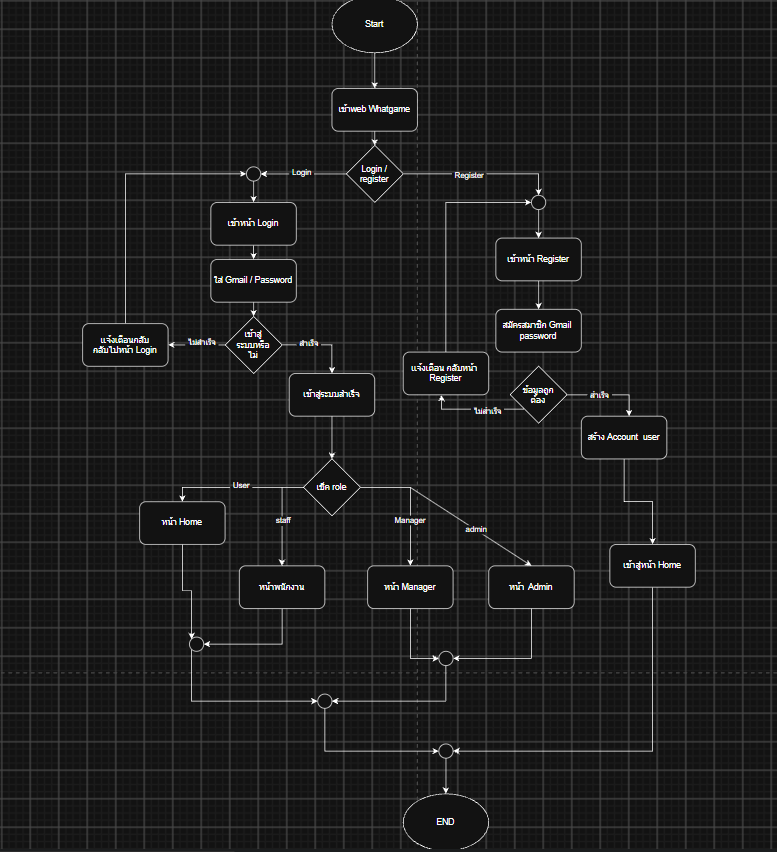

จากผังงานกระบวนการเข้าสู่ระบบ 

	เมื่อผู้ใช้เข้าเว็บไซต์ WhatGame ระบบจะแสดงตัวเลือกให้ผู้ใช้งานเลือกระหว่างการเข้าสู่ระบบหรือ สมัครสมาชิก สำหรับผู้ที่มีบัญชีอยู่แล้วและต้องการ เข้าสู่ระบบ ผู้ใช้งานจะต้องกรอก Gmail และ Password ในหน้า Login หากข้อมูลที่กรอกไม่ถูกต้อง ระบบจะแจ้งเตือนและให้กรอกใหม่อีกครั้ง แต่หากถูกต้องระบบจะ ดำเนินการเช็ค Role เพื่อพาผู้ใช้งานไปยังหน้าที่เหมาะสมต่อไป 

	สำหรับผู้ที่ยังไม่มีบัญชีและต้องการ สมัครสมาชิก ผู้ใช้งานจะต้องกรอกข้อมูล Gmail และ Password ในหน้า Register หากข้อมูลไม่ครบถ้วนหรือไม่ถูกต้อง ระบบจะแจ้งเตือนและให้กลับไปกรอก ข้อมูลใหม่ แต่หากข้อมูลถูกต้องครบถ้วน ระบบจะสร้างบัญชี userและเข้าไปที่หน้า Homepage อัตโนมัติ 

	เมื่อเข้าสู่ระบบสำเร็จ ระบบจะตรวจสอบ Role เพื่อกำหนดสิทธิ์การใช้งาน โดย user
จะถูก นำไปยังหน้า Homepage ในขณะที่ Staff, Admin และ Manager จะถูกนำเข้าสู่ระบบ หน้าพนักงาน ของแต่ ละ Role 

    3. ผังงานกระบวนการฝั่ง  User

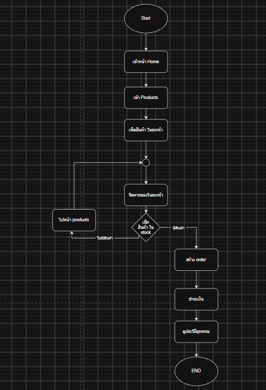

จากผังงานกระบวนการฝั่ง User

	เมื่อ User เข้าสู่ระบบสำเร็จแล้ว ระบบจะนำไปยังหน้า HomePage ซึ่งผู้ใช้งานสามารถ เรียกดูเมนูสินค้าได้ จากนั้นเลือกสินค้าที่ต้องการและเพิ่มเข้าตะกร้า 

	เมื่อเพิ่มสินค้าเรียบร้อยแล้ว ผู้ใช้งานสามารถจัดการของในตะกร้าได้ ไม่ว่าจะเป็นการปรับจำนวน เพิ่ม หรือลบสินค้า รวมถึงใส่โปรโมชั่นโค้ดเพื่อรับส่วนลดได้ในขั้นตอนนี้ 

	จากนั้นระบบจะตรวจสอบว่า มีสินค้าอยุ่ใน stock ถ้าไม่มีจะพาไปหน้า products เเต่ถ้ามีสินค้า
	ระบบจะทำการสร้าง order เเละตัดสินค้าใน stock โดยอัตโนมัติ

	หลังจากนั้นจะพาไปหน้าชำระเงิน เมื่อชำระเงินเสร็จสิ้น จะพาไปหน้าดูธุรกรรม

    4. ผังงานกระบวนการฝั่ง พนักงาน

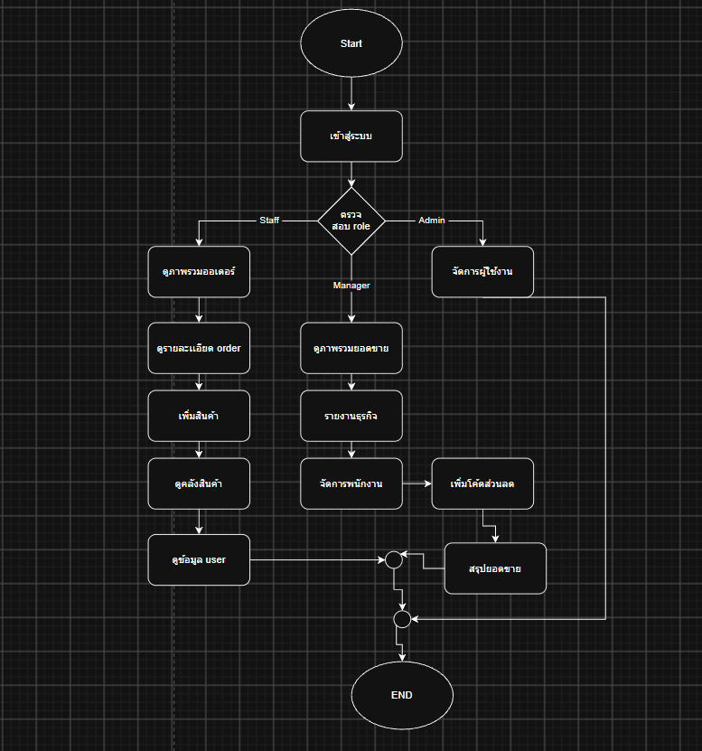

เมื่อผู้ใช้งานเข้าสู่ระบบฝั่ง พนักงาน สำเร็จ ระบบจะพาเข้าสู่กระบวนการหลักของการจัดการร้าน โดยเริ่มจากการตรวจสอบสิทธิ์ (Role) ของผู้ใช้งานว่าเป็น Staff Admin หรือ Manager เพื่อกำหนด ขอบเขตการเข้าถึงและการทำงานของแต่ละคน หากเป็น Staff จะสามารถเข้าถึงฟังก์ชันที่เกี่ยวข้องกับงาน ปฏิบัติการ เช่น การดูรายการออเดอร์ เเละอื่นๆ

	ส่วน Manager จะเน้นไปที่การดูภาพรวมของธุรกิจ โดยสามารถเข้าดู Dashboard ภาพรวมร้าน เช่น ยอดขาย หรือสถานะต่าง ๆ ของระบบ รวมถึงสามารถจัดการระบบหลังบ้าน และจัดการบัญชีพนักงาน เพื่อควบคุมและวางแผนการดำเนินงาน 

	
	ในกรณีที่เป็น Admin จะมีสิทธิ์ในการจัดการข้อมูลหลักของระบบมากขึ้น เช่น การจัดการออเดอร์ การจัดการสินค้า (เพิ่ม แก้ไข ลบสินค้า) รวมถึงการจัดการส่วนลด หรือจัดการผู้ใช้งานและดูแลความถูกต้อง ของข้อมูลภายในระบบ 

5. องค์ประกอบของระบบ
	รหัส
	ชื่อกระบวนการ / องค์ประกอบ
	รายละเอียด
	5.1
	User Registration
	กระบวนการสมัครสมาชิก
	5.2
	Login Validation
	กระบวนการตรวจสอบข้อมูลการเข้าสู่ระบบ
	5.3
	Authentication and Authorization
	กระบวนการยืนยันตัวตนและตรวจสอบสิทธิ์
	D1
	User Database
	ฐานข้อมูลผู้ใช้งาน
	D2
	Role Database
	ฐานข้อมูลบทบาทและสิทธิ์การใช้งาน
	External Entity
	Guest
	ผู้ใช้งานที่ยังไม่ได้เข้าสู่ระบบ

6. กระบวนการตรวจสอบสิทธิ์ผู้ใช้งาน
	กำหนดบทบาทผู้ใช้งานในระบบ 4 ระดับ ได้แก่
	User – ผู้ใช้งานทั่วไป
	Staff – พนักงานผู้ดูแลการดำเนินงาน
	Manager – ผู้จัดการระบบและตรวจสอบรายงาน
	Admin – ผู้ดูแลระบบและจัดการสิทธิ์ผู้ใช้งาน

7. คำอธิบายประกอบแผนภาพ
	กระบวนการ 7.1 User Registration
	ผู้ใช้งานกรอกข้อมูลสำหรับสมัครสมาชิก ระบบจะตรวจสอบความถูกต้องของข้อมูลและตรวจสอบอีเมลที่ซ้ำกับฐานข้อมูล หากข้อมูลถูกต้อง ระบบจะบันทึกข้อมูลสมาชิกใหม่ โดยกำหนดบทบาทเริ่มต้นเป็น User
	กระบวนการ 7.2 Login Validation
	ผู้ใช้งานกรอกอีเมลและรหัสผ่าน ระบบจะนำข้อมูลไปตรวจสอบกับฐานข้อมูลผู้ใช้งาน หากข้อมูลถูกต้องจะส่งข้อมูลไปยังกระบวนการตรวจสอบสิทธิ์
	กระบวนการ 7.3 Authentication and Authorization
	ระบบดำเนินการยืนยันตัวตนและตรวจสอบบทบาทของผู้ใช้งาน จากนั้นกำหนดสิทธิ์ในการเข้าถึงส่วนต่าง ๆ ของระบบตามบทบาทที่ได้รับ ได้แก่ User, Staff, Manager และ Admin

User
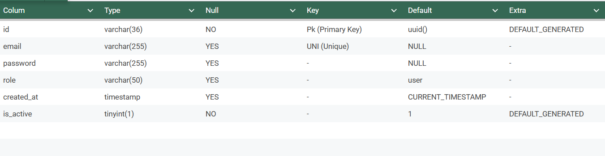

Products

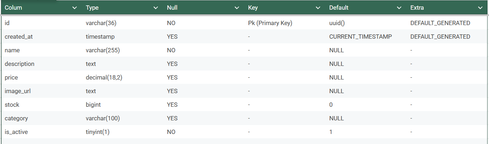

Order 
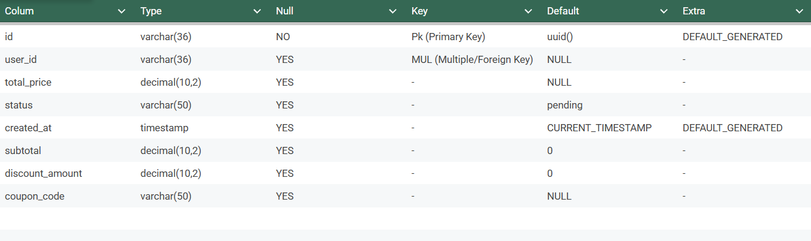

Order_items
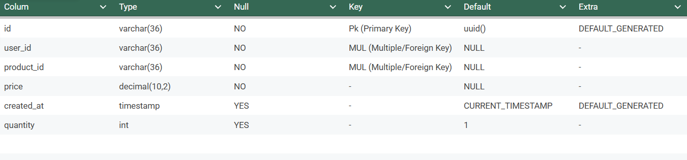

discountcode

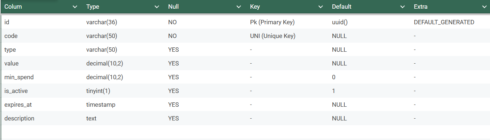

Cart items
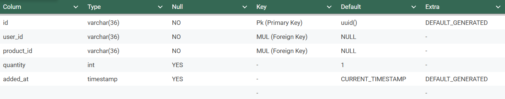

UAT
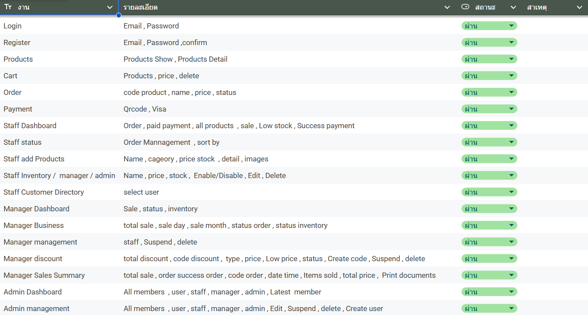